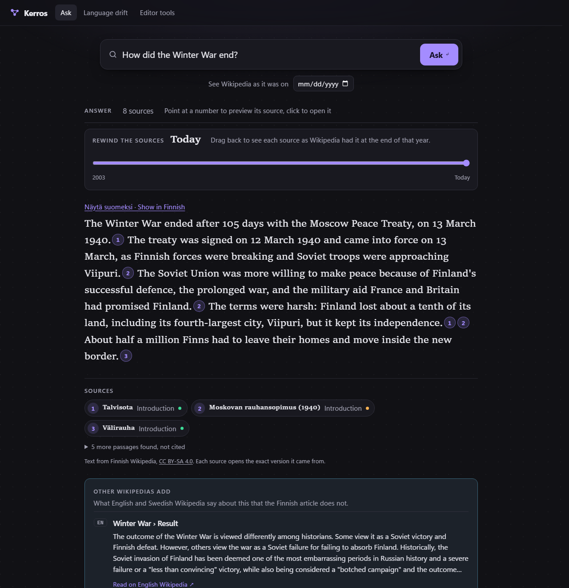
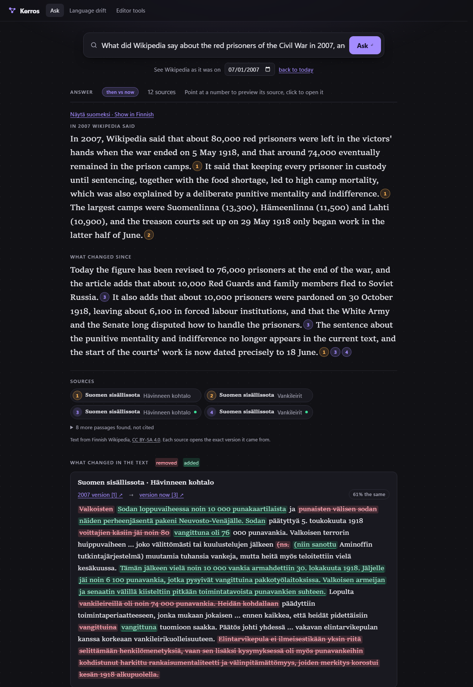
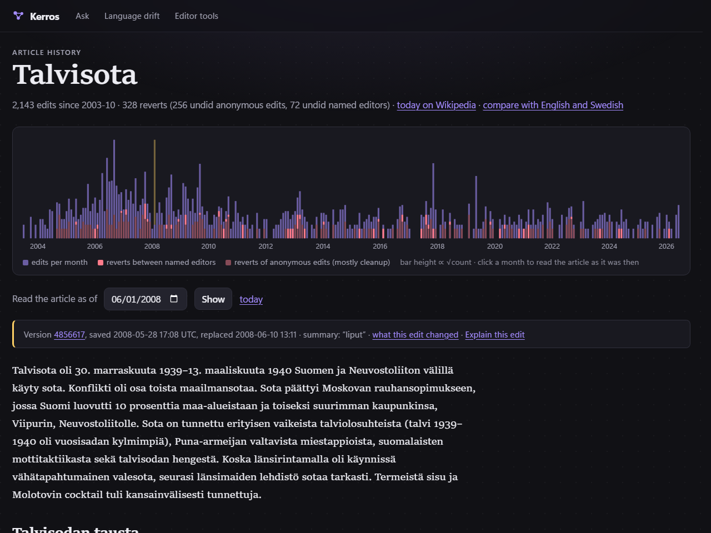
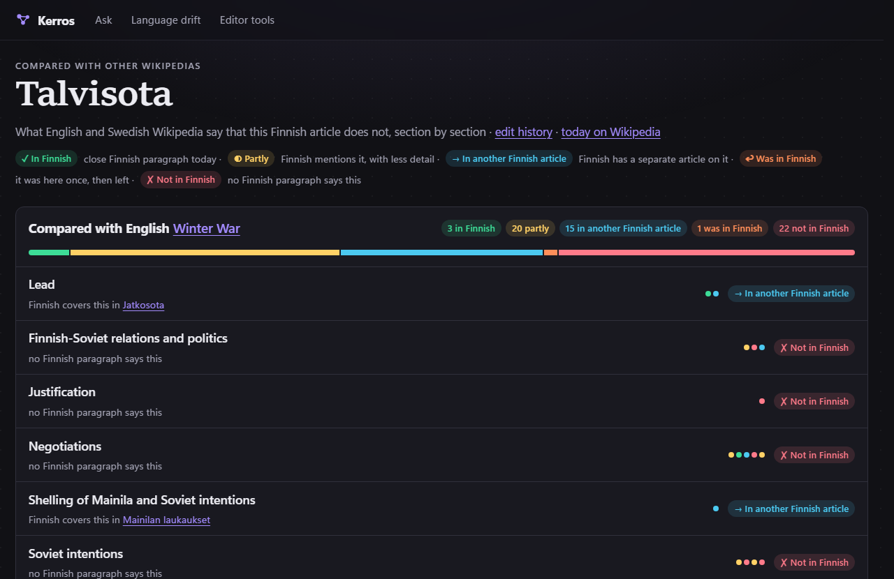
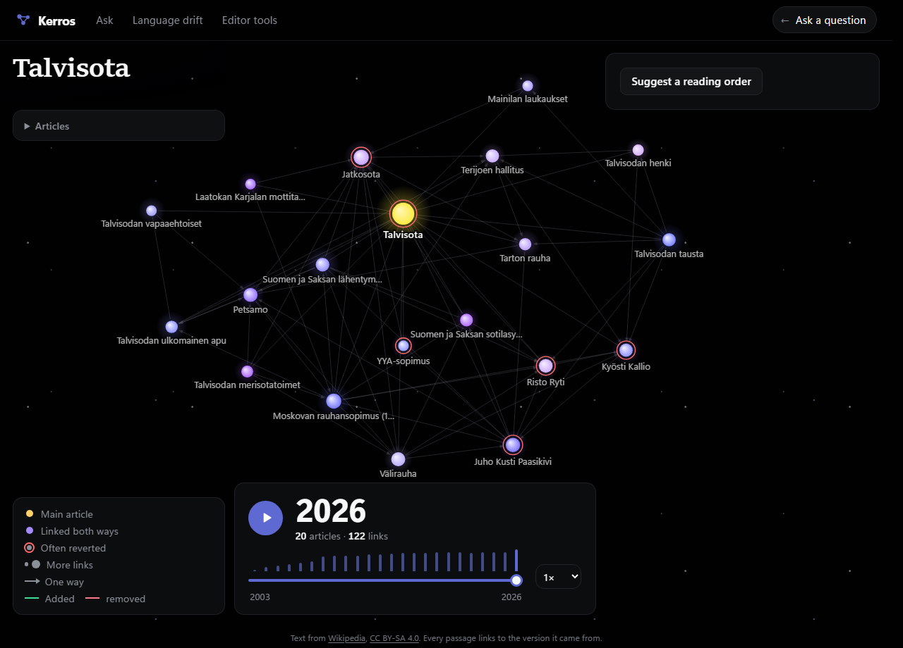
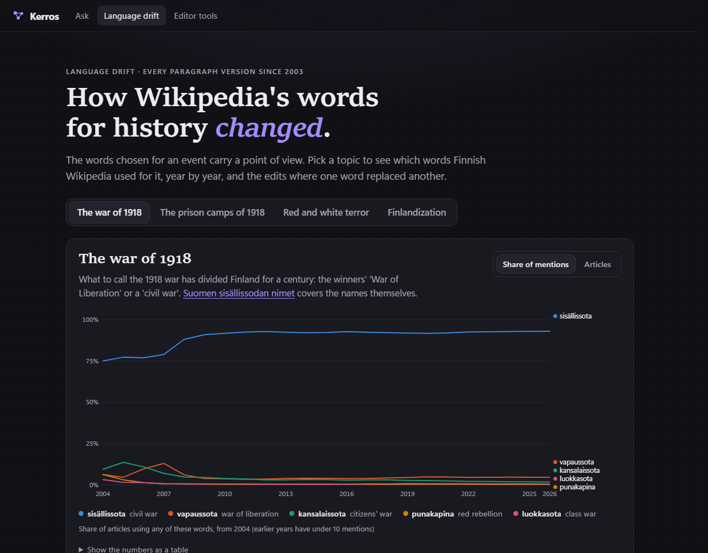
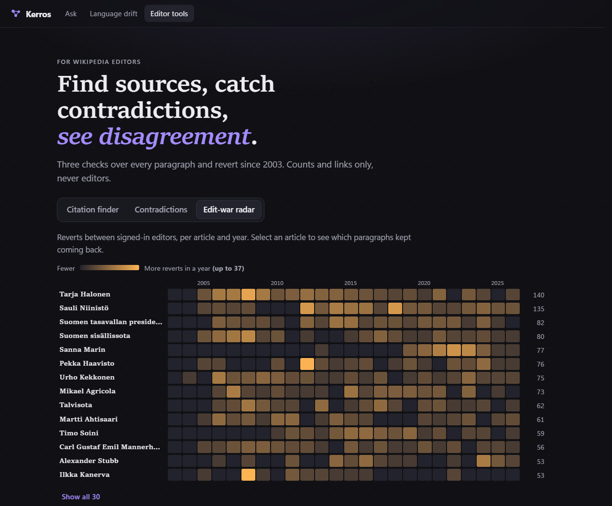
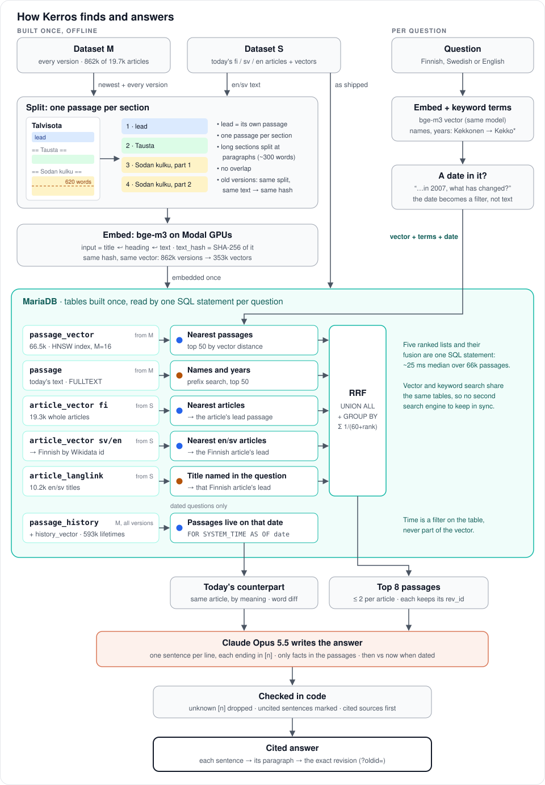
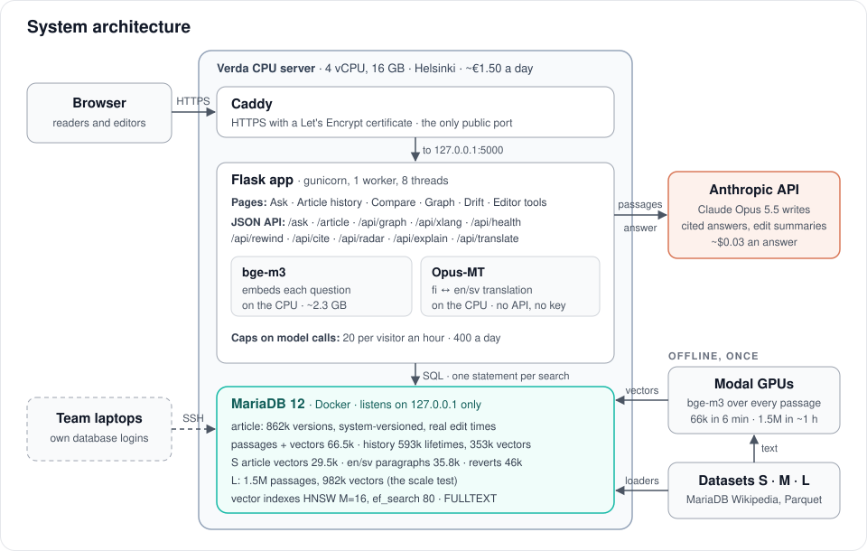

# Kerros

**Finnish history from Wikipedia, with every source and its history.**

Ask a question in English, Finnish or Swedish. Kerros answers from Finnish Wikipedia, cites the
exact paragraph and revision behind every sentence, and then shows how that text got there: when
it was written, how often it was rewritten or reverted, what it said in an earlier year, and what
the English and Swedish Wikipedias say that the Finnish article doesn't.

Built for Junction 2026, MariaDB challenge, by team LakeBandits. MariaDB does the hard parts:
vector search, keyword search and a time filter run in one SQL statement over 862,076 real
Wikipedia revisions.

**Try it:** https://135.181.8.213.compute.verda.run



## What it does

### Cited answers you can check

Every sentence ends with the number of the paragraph it comes from, and every paragraph links to
the exact Wikipedia revision it was taken from. Point at a number to preview the source. Under the
answer: a **rewind slider** that shows each source as Wikipedia had it at the end of any year since
2003, **health dots** (how long a paragraph has stood, how often it was rewritten or restored), and
**what other Wikipedias add**: paragraphs from English or Swedish Wikipedia that answer the
question and that the Finnish article lacks.

### Then vs now

*"What did Wikipedia say about the red prisoners of the Civil War in 2007, and what has changed?"*
The date becomes a filter on the paragraph history, not part of the search text. Kerros finds the
paragraphs live on that date, cites the revision live that day, finds today's version of each by
meaning (headings get renamed), and shows the word-level diff: here *about 80,000* prisoners
became *76,000*, and a sentence on "deliberate punitive mentality" was removed.



### Every source has a history

| | |
| --- | --- |
|  |  |
| **Article history.** 2,143 edits of *Talvisota* since 2003, reverts marked (cleanup of anonymous edits vs reverts between named editors). Click a month to read the article as it was then, with the exact version and a link to what that edit changed. | **Compared with English and Swedish.** Section by section: is this in the Finnish article, only partly, in another Finnish article, was it there once and then removed, or not there at all? |
|  |  |
| **Links through time.** The article and the articles it links to, as real wiki links, with a slider from 2003 to today: watch the web around *Talvisota* grow from 25 links to 122. | **Language drift.** Which words Finnish Wikipedia used for a topic, year by year (*civil war* vs *war of liberation*, *prison camps* vs *concentration camps*), and the edits where one replaced another. |

### Tools for editors



An **edit-war radar** (reverts between named editors, per article and year, then the paragraphs
that kept coming back), a **citation finder** (paste a sentence, get the articles that back it and
the references they use) and a **contradiction finder** (paragraphs elsewhere that state the same
quantity with different numbers). Patterns and diff links only, never editor names.

## Results

| What we measured | Kerros | Baseline |
| --- | --- | --- |
| Right article in the top 5 / top 10, the starter's 37 questions | **92% / 95%** | 76% / 86% (RAG starter) |
| The same over all 568k Finnish articles (dataset L) | **91% / 94%** | 49% / 63% (passage vectors alone) |
| Answers with the expected fact, 21 new questions | **95%** | — |
| Answer citations that support their sentence (judged) | **96%** (82/85) | — |
| Questions Wikipedia can't answer: says so, cites nothing | **3/3** | — |
| Vector index recall@10 · search time, L at 982k vectors | **95.4% · 10 ms** | exact scan: 285 s |
| Vectors needed for every version since 2003 | **353k** for 862k versions | one per version |
| Reverts found over all 862k versions (window functions) | **46,015 in 16 s** | — |
| Answer time (median) | **3.1 s**, ~$0.03 | — |

Method, per-list comparisons and the full scale table: [eval/README.md](eval/README.md).

## How it works



- **One SQL statement per search.** Passage vectors, FULLTEXT on names and years, Finnish and
  English/Swedish whole-article vectors (joined to the Finnish article by Wikidata id) and title
  mentions, fused by reciprocal rank fusion with `UNION ALL` + `GROUP BY`: ~25 ms.
- **Time is a filter, never part of the vector.** Paragraph lifetimes live in a system-versioned
  table loaded with Wikipedia's real edit times (`system_versioning_insert_history`), so
  `FOR SYSTEM_TIME AS OF '2007-07-01'` means "what Wikipedia showed that day".
- **One passage per section, one vector per distinct text.** Old versions are split the same way,
  so an unchanged section keeps its hash and its vector: 862k versions need 353k vectors.
- **Answers you can audit.** Claude writes one sentence per line, each ending in `[n]`; code drops
  any citation that wasn't sent and marks uncited sentences.



Design choices with their evidence, the tables and what MariaDB taught us:
[docs/architecture.md](docs/architecture.md). Pages and JSON API: [docs/frontend.md](docs/frontend.md).

## Data

From [mariadb-wikipedia-datasets](https://github.com/MariaDB/mariadb-wikipedia-datasets):
**S** (19k Finnish history articles plus 10k Swedish and English ones, with article vectors),
**M** (every saved version of 19.7k Finnish articles since 2003: 862,076 versions, raw wikitext),
**L** (all 568k Finnish articles, current text; used for the scale test). Wikipedia text is
CC BY-SA 4.0; every passage shown links to its exact version.

---

## Run it

Needs Docker, Python 3.11+, ~16 GB RAM (bge-m3 needs ~5 GB free) and an Anthropic API key.

```bash
git clone https://github.com/trietle145/kerros && cd kerros
cp .env.example .env              # passwords, LLM_API_KEY; DB_PORT=3307 if 3306 is taken
docker compose up -d              # MariaDB 12, schema.sql applied on first start
python -m venv .venv && . .venv/bin/activate      # Windows: .venv\Scripts\activate
pip install -r requirements.txt   # macOS: brew install mariadb-connector-c first

# Datasets into data/ (git-ignored), checksums verified
for set in s m; do
  mkdir -p data/$set && cd data/$set
  curl -s https://api.github.com/repos/MariaDB/mariadb-wikipedia-datasets/releases/tags/$set-2026-10 \
    | grep -o '"browser_download_url": *"[^"]*"' | cut -d'"' -f4 | xargs -n1 curl -sSLO
  sha256sum -c SHA256SUMS && cd ../..
done
```

Then build the tables in this order. Each script has a `--verify` (or self-check) and its usage
in the docstring; embedding runs on Modal GPUs (`pip install modal && python -m modal setup`).

| Step | Command | Time |
| --- | --- | --- |
| Full history → `article` | `python scripts/load_m.py` | ~12 min |
| S article vectors, en/sv links | `python scripts/load_s.py`, `python scripts/load_langlinks.py` | ~1 min |
| Passages, embedded, loaded | `python scripts/build_passages.py`, `modal run scripts/modal_embed.py`, `python scripts/load_vectors.py` | ~10 min |
| Reverts | `python scripts/build_reverts.py` | 16 s |
| Paragraph lifetimes | `python scripts/build_history.py --all`, embed the new texts, `python scripts/load_vectors.py data/history --history` | ~50 min |
| Cross-language gaps | `python scripts/build_xlang.py passages`, embed, `load`, `label` | ~10 min |

```bash
flask --app app.main run --debug        # http://127.0.0.1:5000
gunicorn -c gunicorn.conf.py app.main:app   # production; bash scripts/setup_public.sh <host> adds HTTPS
```

Settings live in `.env` (see `.env.example`): database login, `LLM_API_KEY`, and the caps on model
calls (`ASK_HOURLY_PER_VISITOR`, default 20; `ASK_DAILY_LIMIT`, default 400).

## Repository layout

| Path | What |
| --- | --- |
| `app/*.py` | Backend: Flask blueprints for search, answers, time, history, cross-language, insights, translation |
| `app/templates`, `app/static` | Frontend: pages, plain HTML/CSS/JS, no build step |
| `scripts/` | Loaders and builders for the tables, server setup and restart |
| `eval/` | Search, answer and scale evaluations ([results](eval/README.md)) |
| `tools/` | Generators for the frontend's fixtures and the drift data |
| `schema.sql`, `docker-compose.yml` | The database |
| `docs/` | [Architecture](docs/architecture.md), [frontend and API](docs/frontend.md), images |

Planning notes and research live on the `planning` branch. Built on the MariaDB starters:
[RAG](https://github.com/MariaDB/mariadb-vector-wikipedia-rag) and
[system versioning](https://github.com/MariaDB/mariadb-system-versioning-wikipedia).
