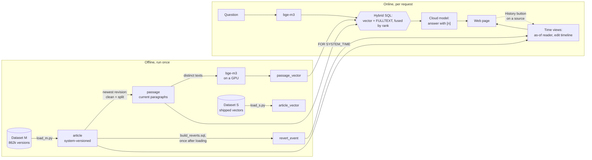
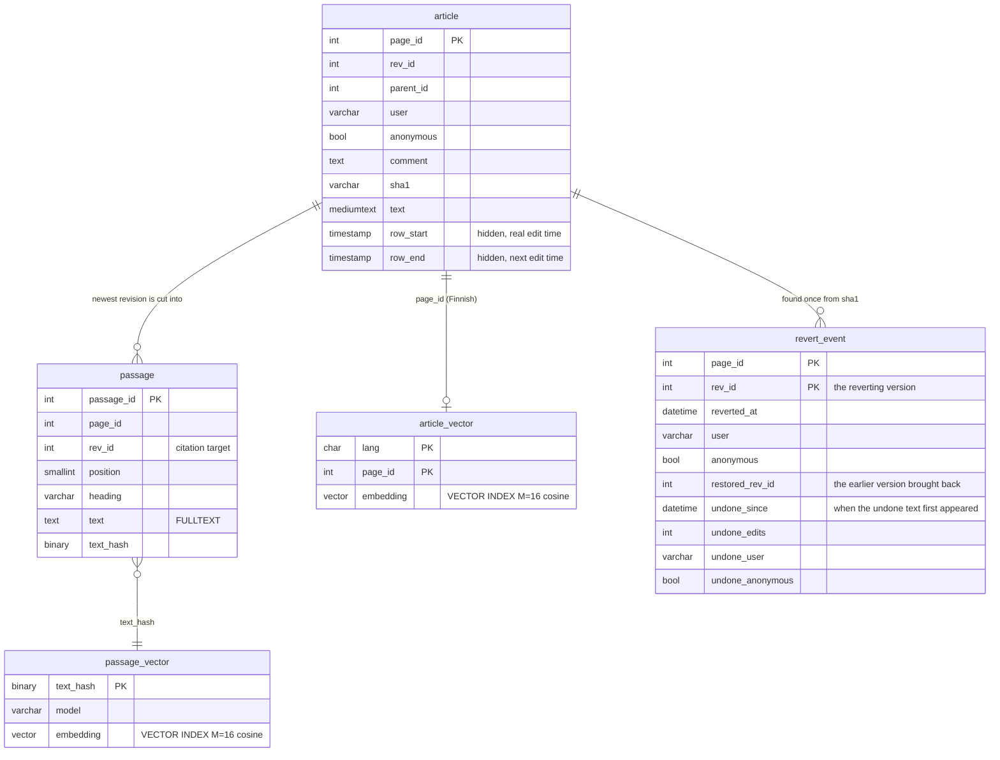
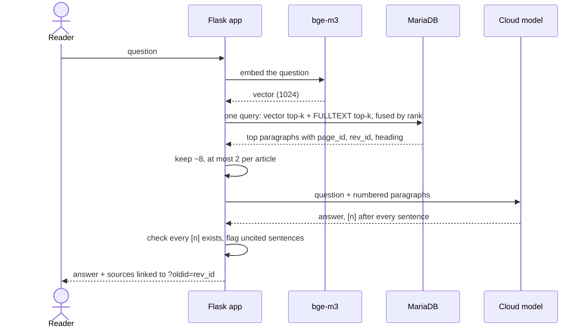
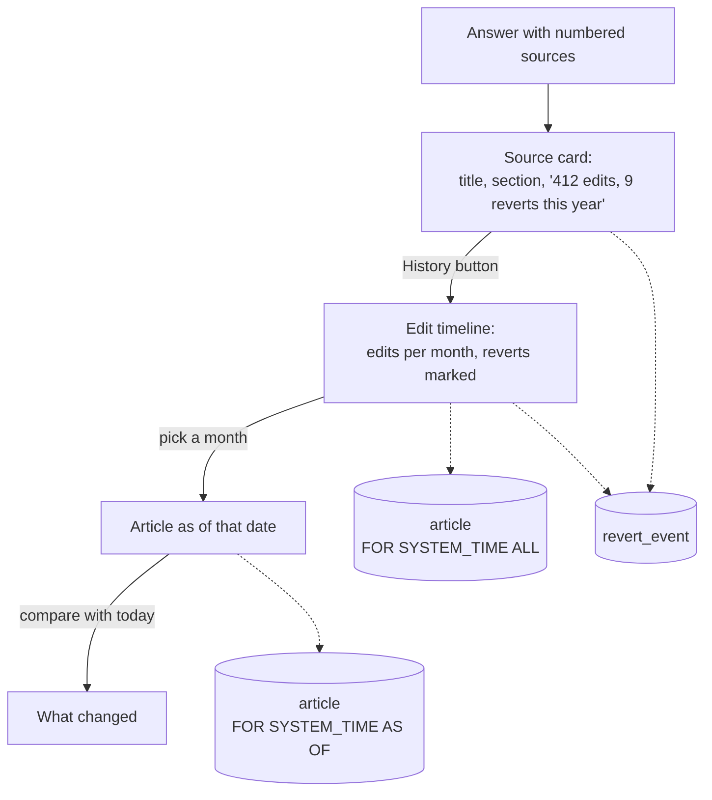

# Architecture: cited Q&A and time views

2026-11-13. Retrieval approach decided: **hybrid (B)**. The rest follows from decisions already
made (see `plan.md`). The time side was decided the same day (see "The time side"). Feature
ideas stay an open list in `ideas.md`.

## What the core does

A person asks a question about Finnish history in Finnish, Swedish or English. The app finds the
Wikipedia paragraphs that answer it and writes a short answer where every sentence cites its
paragraph by number. Each citation links to the exact Wikipedia revision the text came from. A
second mode summarises one article with the same citations.

This is the RAG track's core: retrieval from MariaDB, an answer with sources, a summary.

Next to it sit two time views from the SVT track: read any article as it stood on a chosen date,
and see an article's edit timeline with its reverts. The two sides meet on the source card under
an answer: each cited source has a History button.

## Base now, time features later

Everything in this document up to "Notes for the time features" is the **base**. It is built
first and stays as it is.

| | What it is | Status |
| --- | --- | --- |
| Base | Cited Q&A and summaries over today's paragraphs (RAG); article as of a date and edit timeline with reverts (SVT) | Build first |
| Highlight | One feature through time from `ideas.md`, for example the same question answered as of a chosen year | Added on top; which one is open |

Two things to keep in mind:

- **The base alone is not the demo.** In the base, RAG answers from today's text and SVT shows
  article history, side by side, joined only by the History button. Both starters already do
  their half. What no starter does is search and time in the same query, and that is what the
  highlight adds.
- **Three things are costly to change later**, because changing them means embedding everything
  again or loading all night again: the chunking rule, the exact text that is embedded, and the
  full history load. Old paragraph versions must be split and embedded the same way as current
  ones, or their hashes and vectors will not match. Everything else can be rebuilt from the
  Parquet files in minutes to hours.

## Approaches for retrieval

| | How it finds paragraphs | Good at | Weak at |
| --- | --- | --- | --- |
| A. Vector only | Nearest paragraph vectors to the question vector | Meaning, cross-language | Exact names, years, rare words |
| **B. Hybrid (chosen)** | Paragraph vectors and MariaDB `FULLTEXT` in one SQL statement, merged by rank (reciprocal rank fusion) | Meaning *and* exact names and years, e.g. "president 1956–1982" | Finnish word endings may weaken the keyword half (to test) |
| C. Two-stage | Shipped article vectors pick the top articles, then paragraph vectors within them | Cheap, uses the S vectors | Misses facts in articles the first stage skipped |

**Decision: B, built as A first.** B is A plus one more query, so A works on day one and B
follows. B is also a strong "MariaDB feature used well" point, and MariaDB documents the pattern:
[Optimizing Hybrid Search Query with Reciprocal Rank Fusion](https://mariadb.com/docs/server/reference/sql-structure/vectors/optimizing-hybrid-search-query-with-reciprocal-rank-fusion-rrf).
C stays useful later for cross-language features.

## System overview



Everything in the offline box runs once (or overnight); everything in the online box runs per
request. The two tracks meet in one place: a cited paragraph (`passage`) carries the
`page_id` and `rev_id` that the time views read from `article`.

## Tables and how they join



Full definitions: `schema.sql`.

## Asking a question



The summary mode is the same flow with one article's paragraphs instead of a search.

## The time side

Decided: two time views are part of the core, reverts are found once and stored, the Q&A answers
from the newest text (a date is accepted but ignored for now), and the two sides meet on the
source card.



**The two views, one query each**

```sql
-- Read an article as it stood on a date.
SELECT title, rev_id, text FROM article FOR SYSTEM_TIME AS OF '2015-06-01' WHERE page_id = ?;

-- Edit timeline: edits per month (reverts per month come from revert_event the same way).
SELECT DATE_FORMAT(row_start, '%Y-%m') AS month, COUNT(*) AS edits
FROM article FOR SYSTEM_TIME ALL WHERE page_id = ? GROUP BY month;
```

Both depend only on dataset M being loaded into `article`. Nothing else is needed.

**Reverts are found once.** A revert is a version whose text (same `sha1`) already existed earlier
in the same article, with other versions in between. After the load, one statement fills
`revert_event` (sketch, not yet run):

```sql
INSERT INTO revert_event
SELECT x.page_id, x.rev_id, x.row_start, x.user, x.anonymous,
       x.prev_rev_id, x.prev_end, x.rn - x.prev_rn - 1,
       u.user, u.anonymous
FROM (
  SELECT v.*, LAG(rev_id)  OVER w AS prev_rev_id,   -- the earlier version with the same text
              LAG(row_end) OVER w AS prev_end,      -- = when the first undone edit was saved
              LAG(rn)      OVER w AS prev_rn
  FROM (SELECT page_id, rev_id, user, anonymous, sha1, row_start, row_end,
               ROW_NUMBER() OVER (PARTITION BY page_id ORDER BY row_start) AS rn
        FROM article FOR SYSTEM_TIME ALL) v
  WINDOW w AS (PARTITION BY page_id, sha1 ORDER BY row_start)
) x
JOIN article FOR SYSTEM_TIME ALL u            -- the first undone edit: who was reverted
  ON u.page_id = x.page_id AND u.row_start = x.prev_end
WHERE x.rn - x.prev_rn > 1;                   -- something in between was undone
```

Each row answers: who undid whom, when, how many edits were undone, and how long the undone text
stayed visible (`reverted_at - undone_since`). The edit-war and vandalism ideas in `ideas.md`
become plain queries on this table. Known limit: an exact-text match misses partial reverts and
rewordings. To check on the first run: versions with no `sha1` and blanked pages all share one
"text", so they would show up as false reverts and need filtering out.

**Time in the Q&A.** Questions are answered from the newest text. The ask endpoint accepts an
optional `as_of` date from the start and ignores it for now, so "ask the past" can be added later
without changing the interface. It stays in `ideas.md`.

**The source card** is a UI choice with no storage of its own: its numbers come from a count on
`article` and on `revert_event` for that `page_id`.

**Partitions.** The history table keeps the starter's yearly partitions. They cost about 25% more
disk and do not speed up queries at this size, but they show time partitioning in use and let old
years be archived.

## Three choices that keep the feature ideas open

1. **Vectors are keyed by text hash, not by paragraph position.** The same text is embedded once,
   however many articles or revisions contain it. Old paragraph versions can get vectors later by
   embedding only the texts not seen yet, which is what "ask the past" and "meaning drift" need.
2. **Every paragraph keeps the revision it came from.** Citations point at an exact revision, and
   the history features can join any paragraph back to the versioned `article` table.
3. **The full history loads now, even though the core only reads the newest revision.** The
   edit-war, vandalism and "what changed" ideas all start from that table, and the load takes all
   night.

Nothing in `ideas.md` needs the core to change; those ideas add tables (revert events, paragraph
lifetimes) next to these.

## Code layout

| Path | Does |
| --- | --- |
| `scripts/load_m.py` | Parquet → versioned `article` table (real timestamps, resumable) |
| `scripts/load_s.py` | Shipped S vectors → `article_vector` |
| `scripts/build_reverts.sql` | Fills `revert_event` from `article`, once after loading |
| `scripts/build_passages.py` | Newest revision → cleaned paragraphs → `passage`; writes the distinct texts to embed |
| `scripts/embed_passages.py` | bge-m3 over the distinct texts → parquet of `text_hash, embedding`; runs wherever a GPU is |
| `scripts/load_vectors.py` | That parquet → `passage_vector`, then builds the vector index |
| `app/db.py` | Connection and the retrieval queries |
| `app/embed.py` | Question → vector (bge-m3, same model and settings as the notebook) |
| `app/llm.py` | Answer and summary prompts; provider read from a setting |
| `app/main.py` | Flask: the page, `/ask` (optional `as_of`, unused for now), `/summarise/<page_id>`, `/article/<page_id>?as_of=`, `/article/<page_id>/timeline`, and a JSON API the extension or MCP can use later |
| `schema.sql` | All five tables; runs on any MariaDB 11.7+ |
| `eval/evaluate.py` | Retrieval and citation checks (below) |

## Evaluation

The starter's 37 test questions only check that the right *article* is found. Our claim is about
paragraphs and citations, so we measure three things:

1. **Article found:** the 37 questions, right article in the top 5 / top 10, against the starter's
   76% / 86%.
2. **Paragraph found:** 20 to 30 of our own questions, each with the paragraph that answers it,
   written by hand from a few hero articles. Right paragraph in the top 5 / top 10.
3. **Citations faithful:** for each answer sentence, does the paragraph it cites actually say it?
   Checked by hand on the same questions at first; a model-graded check later if time allows.

## Runtime is set up per machine

Nothing in the schema or the code depends on where things run. Each machine sets its own `.env`:
database host and port (Docker, portable MariaDB or a cloud database), where bge-m3 runs for
questions (local Ollama or a hosted endpoint), and the cloud model for answers. The one rule:
paragraphs and questions are embedded with the same model and settings.

## First hour: checks before building on them

- A MariaDB 11.7+ is running somewhere with ~15 GB free.
- `schema.sql` runs, and a vector search and a `FULLTEXT` search each return rows on a handful of
  test paragraphs.
- Five questions embedded on the GPU machine and on the query machine give the same vectors
  (cosine similarity above 0.99).
- The starter's wikitext cleaner gives readable paragraphs on 3 hero articles.
- Finnish `FULLTEXT`: does a search for "Kekkonen" find "Kekkosen"? If not, the vector half
  carries word endings and the keyword half carries exact names and years.

## Settings decided for now

- Paragraph = one paragraph, short ones merged up to ~300 words; the title and section heading are
  prepended only when embedding, not in the stored text.
- `SET mhnsw_ef_search = 80`; re-measure recall once all paragraph vectors are in.
- Vector search goes in a subquery and is joined afterwards, so the index is used.
- Top 8 paragraphs, at most 2 per article, go to the model.
- The answer is in the question's language; the sources stay in their own language.

## What adding a feature later costs

No idea in `ideas.md` changes the core tables or the ask flow. They fall into four groups:

| Group | Ideas | What gets added |
| --- | --- | --- |
| Queries over the loaded history | Edit-war radar, vandalism survival time, how the story grew, what changed since | Queries on `revert_event` and `article`, plus pages. No new data. |
| Paragraphs over time | Contested-paragraph lens, trust badges, citation history | A `passage_history` table that tracks paragraph lifetimes across revisions. The biggest single addition; the core's `passage` table stays as it is. |
| More embedding | Ask the past, meaning drift, three languages | More rows in `passage_vector` (old versions, or sv/en paragraphs). Same table, same index, more GPU time. |
| Outside the database | Source check; extension; MCP server | Fetched web pages in their own table; or a thin client on the JSON API. |

## Notes for the time features

From the review on 2026-11-13. None of these changes the base; they are the points to settle
when `passage_history` and "ask the past" are built.

- **Paragraph lifetimes.** `passage_history` holds one row per paragraph and lifetime: `page_id`,
  `text_hash`, when it appeared and when it went. Load it as a system-versioned table with the
  real edit times, like `article`, so that "the paragraphs of this article in 2010" is a
  `FOR SYSTEM_TIME AS OF` query.
- **No position in a lifetime row.** If position is stored, adding one paragraph near the top
  "changes" every paragraph below it and the history fills with false edits. Show past articles
  from `article`; search does not need the order.
- **Old paragraph texts need a home.** `passage` holds today's paragraphs only, and its
  `FULLTEXT` index covers only those. Old texts go in a plain table keyed by `text_hash` with its
  own `FULLTEXT` index, next to `passage_vector`.
- **The date filter comes after the vector search.** The index returns its nearest texts from all
  years, and many are near-identical versions of one paragraph. Fetch about 200, join to the
  paragraphs alive on the date, drop duplicates, keep 8. Time this early: a filtered vector
  search fell back to a full scan (2 s) in the starter.
- **Cite the version that was live.** An answer as of a date links to the article revision live
  on that date, not to the revision where the paragraph first appeared.
- **Keep the build cheap.** Split each old version into raw paragraphs and hash them first; clean
  only the hashes not seen before. Embed only texts that stayed up for about a day or more, so
  short-lived vandalism costs no GPU time. Count the distinct texts on the pilot articles before
  running all 19,742.
- **Evaluation.** Add 5 to 10 questions whose right answer differs by year, checked in the data.
  They also serve as the demo script.
- **Hero articles.** Check that the 3 hero articles have paragraphs that really changed before
  building the page around them. Whether the name of the 1918 war was changed on Finnish
  Wikipedia is not confirmed.

## Open

- Which cloud model, and which credits pay for it.
- How well `FULLTEXT` handles Finnish word endings, and whether the starter's wikitext cleaner is
  good enough for paragraphs.
- Which time feature is the highlight (`ideas.md`).
- The vector is keyed by the hash of the paragraph text, but the text embedded also has the
  title and heading in front. The same text under another heading reuses the first vector. Accept
  this for now; it mostly affects boilerplate paragraphs. Revisit if search results look wrong.
