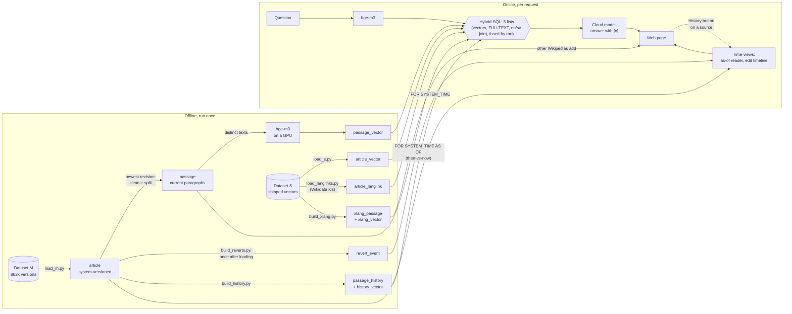
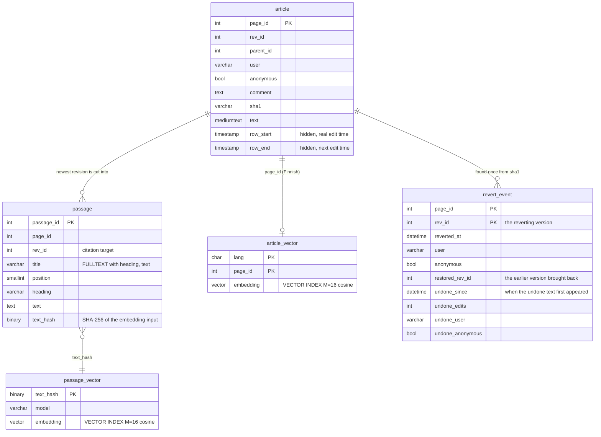
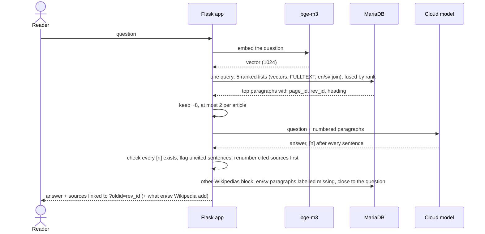
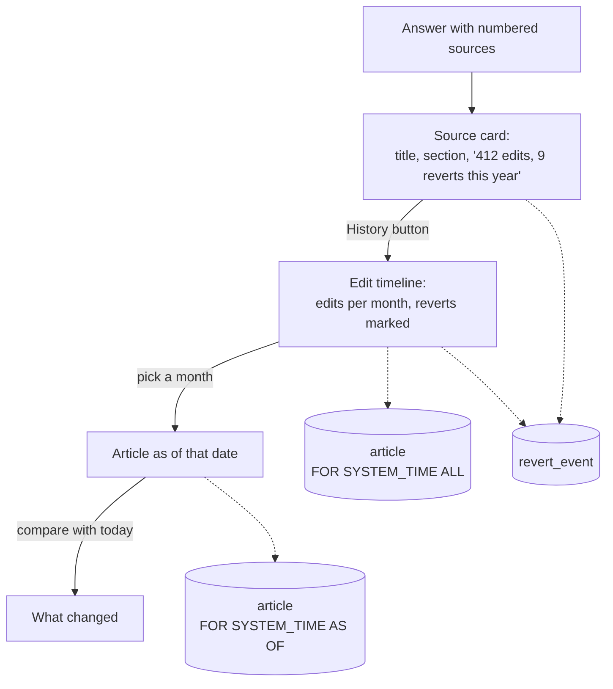

# Architecture: cited Q&A and time views

2026-11-13, updated 2026-11-14 evening (as built). Retrieval: **hybrid, five lists fused in one
SQL statement**. Built on top of the base: then-vs-now answers ("Time-aware retrieval"), the
cross-language gaps ("Cross-language gaps"), and dataset L at scale ("Scale: S → M → L"). What
MariaDB cost us to learn is in "MariaDB: what it costs". Feature ideas: `tasks/plan.md` (Phase 3).

## What the core does

A person asks a question about Finnish history in Finnish, Swedish or English. The app finds the
Wikipedia paragraphs that answer it and writes a short answer where every sentence cites its
paragraph by number. Each citation links to the exact Wikipedia revision the text came from. A
second mode summarises one article with the same citations.

This is the RAG track's core: retrieval from MariaDB, an answer with sources, a summary.

Next to it sit two time views from the SVT track: read any article as it stood on a chosen date,
and see an article's edit timeline with its reverts. The two sides meet on the source card under
an answer: each cited source has a History button.

The highlight joins them in one question: *"what did Wikipedia say about this in 2008, and what
has changed since?"* (section "Time-aware retrieval"). Built and working on all 862,076 versions.

A third view compares across languages: what English and Swedish Wikipedia say that the Finnish
article does not, and when the Finnish article covered it (section "Cross-language gaps").

## Design choices at a glance (for the pitch)

Every choice below was measured on our data (2026-11-14). Numbers are what to quote; the
trade-off column is what to say when a judge pushes back.

| Choice | Why | Evidence | Trade-off |
| --- | --- | --- | --- |
| **Passage = one section** (long ones split at paragraphs, ≤ ~300 words), not fixed windows, not whole articles | An edit changes only its own section, so passage boundaries stay stable across versions: that is what makes history per passage possible. Sections are also a natural size to cite | 66,642 passages, median 79 words. Old versions split the same way give **0 hash mismatches** with today's passages | 10 single paragraphs over 300 words are kept whole |
| **Keep the whole-article vectors too, fused with passages** | Whole articles find the *topic*, passages find the *fact* and give the paragraph to cite | Passages alone: hit@1 43%, hit@10 70%. Articles alone: hit@1 22%, hit@10 78%. Fused: hit@5 76%, hit@10 84–86% (= the starter's best, with paragraph-level citations) | One extra vector query (~4 ms) |
| **Cross-language search as a join** (en/sv article vectors of dataset S → their Finnish article by Wikidata id, `article_langlink`) | An English question meets an English article vector first, then crosses to the Finnish passages, in the same SQL statement | **hit@5 73% → 92%, hit@10 86% → 95%**, hit@1 35% → 51%; no extra model, no translation call, ~3 ms | Only for the 7,256 Finnish articles with an en/sv counterpart in S |
| **Title mentions as a fifth list** (an en/sv title written verbatim in the question) | Long articles have diluted whole-article vectors: "Finnish Civil War" did not rank its own article | Fixes the then-vs-now question on the Finnish Civil War; eval unchanged | Two-word titles and up only |
| **Keyword half = names and years only** (capitalised words, numbers; Finnish prefix terms like `kekko*`) | FULLTEXT has no Finnish stemming; prefix terms on every word over-match common stems | Every word: hit@5 70%. Names and years: **76%**, and faster (35 → 24 ms) | Chosen on the 37 eval questions: confirm on new questions |
| **Fusion by RRF in one SQL statement** (`UNION ALL` + `GROUP BY`, k = 60) | No FULL OUTER JOIN in MariaDB; one round trip; the pattern MariaDB documents | Whole hybrid search: 24 ms median | Weights are equal per list (not tuned) |
| **Vector index `M=16`, `ef_search=80`** | The default `M=6` found only 79% of the true top 10 | recall@10 **99.2–99.8%** at 66k vectors, 11–17 ms | Bigger index than the default |
| **bge-m3, pinned, one `embed()` for passages and questions** | Multilingual (fi/sv/en questions on Finnish text); the same model as the shipped S vectors | GPU-made and CPU-made vectors: cosine **1.0**. Embedded on Modal (66k in 6.4 min, 283k in 15 min); questions on the server's CPU | Needs ~5 GB free memory to load; English/Swedish questions match a bit worse than Finnish |
| **Vectors keyed by text hash** | An unchanged passage is embedded once, however many versions contain it | 862,076 versions → 530,885 distinct texts → **353,166 embedded** (texts live ≥ 1 day; vandalism costs no GPU time) | — |
| **Real edit times via `system_versioning_insert_history`** | `AS OF '2008-06-01'` means "what Wikipedia showed that day" | For 15 versions 2003–2026, `AS OF` returns exactly that version's passages | — |
| **Reverts by window functions** | One `INSERT … SELECT` over all versions instead of a Python loop | **46,015 reverts in 16 s**; Talvisota 328 = the SVT starter's count; 82% carry an undo/rollback summary (3% of other edits) | sha1 misses partial reverts |
| **Time is a filter, never in the vector** | Validity is a date range; a year in the question would pull towards passages that *mention* that year | Then-vs-now answers find real revisions (Red prisoners 80,000 → 76,000; Mainila "probably" → "possibly") | Needs a date router |
| **Today's counterpart by meaning, not by heading** | Headings get renamed | *Moskovan neuvottelut* (2008) → *Suomen ja Neuvostoliiton neuvottelut aluemuutoksista*, distance 0.13 | — |
| **Answers: Claude Opus 5.5, one sentence per line ending in `[n]`, validated in code** | Every claim checkable; invalid numbers dropped, uncited sentences shown as uncited; cited sources renumbered 1, 2, … and shown first | 19/19 sentences cited in the tests, fi/en/sv; ~3–4 s, ~$0.03 per answer | Cost per answer; server-side fallback to Opus 4.8 if a request is declined |
| **Cross-language gaps labelled in SQL** (en/sv paragraph vs every Finnish paragraph, now and through history) | "What does English Wikipedia say that Finnish doesn't, and did Finnish ever say it?": both tracks again | 35,829 en/sv paragraphs for 7,256 articles labelled in 5 min | Fixed distance cut-offs; "partly" is the grey zone |
| **Scale on dataset L in the same tables and index settings** | The scalability criterion: 1.5M passages of all 568k Finnish articles | Embedded on Modal in ~1 h; load and search numbers in "Scale: S → M → L" | Index build is one writer at a time (~65–740 inserts/s) |
| **One always-on CPU server, MariaDB never public** | Cheap; GPU only for embedding runs; team access by SSH tunnel | ~€1.50/day; all data loaded and verified on it | One machine = one point of failure |

## Base now, time features later

Everything in this document up to "Notes for the time features" is the **base**. It is built
first and stays as it is.

| | What it is | Status |
| --- | --- | --- |
| Base | Cited Q&A and summaries over today's paragraphs (RAG); article as of a date and edit timeline with reverts (SVT) | Build first |
| Highlight | One feature through time from the feature pool in `tasks/plan.md`, for example the same question answered as of a chosen year | Added on top; which one is open |

Two things to keep in mind:

- **The base alone is not the demo.** In the base, RAG answers from today's text and SVT shows
  article history, side by side, joined only by the History button. Both starters already do
  their half. What no starter does is search and time in the same query, and that is what the
  highlight adds.
- **Three things are costly to change later**, because changing them means embedding everything
  again or loading all night again: the chunking rule, the exact text that is embedded, and the
  full history load. Old paragraph versions must be split and embedded the same way as current
  ones, or their hashes and vectors will not match. Everything else can be rebuilt from the
  Parquet files in minutes to hours.

## Approaches for retrieval

| | How it finds paragraphs | Good at | Weak at |
| --- | --- | --- | --- |
| A. Vector only | Nearest paragraph vectors to the question vector | Meaning, cross-language | Exact names, years, rare words |
| **B. Hybrid (chosen)** | Paragraph vectors and MariaDB `FULLTEXT` in one SQL statement, merged by rank (reciprocal rank fusion) | Meaning *and* exact names and years, e.g. "president 1956–1982" | Finnish word endings: handled by prefix search (below) |
| C. Two-stage | Shipped article vectors pick the top articles, then paragraph vectors within them | Cheap, uses the S vectors | Misses facts in articles the first stage skipped |

**Decision: B, built as A first.** B is A plus one more query, so A works on day one and B
follows. B is also a strong "MariaDB feature used well" point, and MariaDB documents the pattern:
[Optimizing Hybrid Search Query with Reciprocal Rank Fusion](https://mariadb.com/docs/server/reference/sql-structure/vectors/optimizing-hybrid-search-query-with-reciprocal-rank-fusion-rrf).

**As built (2026-11-14): five ranked lists fused by RRF in one statement** (`app/search.py`):

| List | What it ranks | Each hit contributes |
| --- | --- | --- |
| `vec` | nearest passage vectors | that passage |
| `ft` | `FULLTEXT` on names and years (Finnish prefix terms) | that passage |
| `art` | nearest Finnish whole-article vectors (dataset S) | its article's lead passage |
| `xl` | nearest English/Swedish whole-article vectors (S), joined to their Finnish article through `article_langlink` (Wikidata id) | that Finnish article's lead passage |
| `name` | English/Swedish titles of two words or more written verbatim in the question | that Finnish article's lead passage |

Measured on the starter's 37 questions (right Finnish article among the top distinct articles):

| Lists | hit@1 | hit@5 | hit@10 | SQL median |
| --- | --- | --- | --- | --- |
| passage vectors | 43% | 65% | 70% | 4 ms |
| + whole-article vectors | 35% | 73% | 86% | 8 ms |
| + FULLTEXT, every word | 43% | 70% | 84% | 35 ms |
| + FULLTEXT, names and years | 38% | 76% | 84% | 15 ms |
| **+ en/sv article vectors + title mentions (built)** | **51%** | **92%** | **95%** | 18–25 ms |
| starter (whole articles, a hit in any language) | — | 76% | 86% | — |

Why the `xl` list works: an English question is closest to the *English* article on the topic,
and the shipped S vectors include 10,175 English and Swedish articles. Matching by Wikidata id
turns that into the Finnish article inside the same statement, with no translation call. Before
it, *"What caused the Finnish Civil War?"* found the 1808 Finnish War; *Suomen sisällissota* is
now in the top 2. The `name` list catches long articles whose whole-article vector is too diluted
to rank even for its exact title.

Remaining misses (2 of 37): English questions that name no article (*"The 1918 war between the
Reds and the Whites"*, *"Who led the Senate that declared Finland independent?"*). The lever left
is translating the question to Finnish before searching (one small model call per question).

## Chunking, embedding and keyword search

Decided 2026-11-14 after looking at other Wikipedia RAG systems and measuring our own articles.

**What others do.** DPR and the original RAG paper cut Wikipedia into disjoint 100-word blocks,
each carrying its article title (21M passages); a later study found the fixed cut breaks
sentences. Cohere's multilingual Wikipedia set is paragraph-level (2.4M Finnish passages). The
MariaDB RAG starter embeds whole articles (76% top-5) and lists chunks and hybrid + RRF as its own
next steps. Anthropic's contextual retrieval puts context in front of each chunk and adds BM25:
top-20 failure rate 5.7% → 3.7% (context) → 2.9% (+ keyword search) → 1.9% (+ reranking).

**Our articles** (newest versions, crude cleaning, measured 2026-11-14): 19,600 articles (142
redirects skipped), 6.8 million words. Median article 180 words, 69% under 300 words. Raw
paragraphs are small (median 39 words, half under 40). Sections are a natural size (median 77
words, 95% under 300).

**Chunking: one passage per section.**
- The lead (text before the first heading) is its own passage; each section is one passage.
- A section over ~300 words is split at paragraph boundaries into pieces of up to ~300 words.
- Never merge across sections; no overlap.
- Skip reference and link sections: Lähteet, Viitteet, Aiheesta muualla, Katso myös,
  Kirjallisuutta. The en/sv paragraphs (cross-language gaps) skip their own equivalents
  (References, Bibliography, Literature, Källor, …) and book lists under neutral headings.
- Expected: about 67,000 passages, median ~80 words, 95% under ~265 words.
- Why sections, not fixed windows: an edit changes only its own section's passage, so passage
  boundaries stay stable across versions. The time features (paragraph lifetimes, "ask the past")
  depend on that; fixed windows would shift with every edit.

**Embedding.**
- bge-m3 dense, 1024 dimensions, normalised, cosine; the same model as the shipped S vectors and
  the starter's measurements.
- Passage input: `title + "\n" + heading + "\n" + text`. Question input: the question as typed.
  Max length 1,024 tokens (a 300-word Finnish passage is roughly 600 tokens).
- `text_hash` = SHA-256 of that exact embedding input, so one hash means one vector, and an
  unchanged section in an old version reuses its vector.
- ~67k passages: minutes on a GPU, roughly 1–3 hours on a CPU.

**Keyword half: prefix search for Finnish.** MariaDB `FULLTEXT` matches whole words and has no
Finnish stemming. Measured on 12.3: `MATCH … AGAINST('Kekkonen')` finds only "Kekkonen";
`AGAINST('Kekko*' IN BOOLEAN MODE)` also finds "Kekkosen" and "Kekkoselle"; years and hyphenated
names ("YYA-sopimus") match exactly. So Python turns the question into boolean prefix terms:
- words of 6+ letters keep all but their last 3 letters (at least 4) and get `*`:
  Kekkonen → `Kekko*`, talvisota → `talvis*`, presidentti → `presiden*`;
- numbers and shorter words stay exact; a few question words (mikä, milloin, kuka…) are dropped;
- the index covers `FULLTEXT(title, heading, text)`, so a question naming an article finds its
  passages.
Known cost: short stems over-match (`Turk*` → Turku and Turkki); the vector half outvotes them in
the fusion. Tune the rule against the evaluation.

**Fusion: reciprocal rank fusion in one SQL statement.** Top 50 from the vector side and top 50
from the keyword side; each passage scores `1/(60 + rank)` per side it appears in; sum, order,
keep the top. MariaDB 12.3 has no `FULL OUTER JOIN` (tested), so the two lists are combined with
`UNION ALL` + `GROUP BY passage_id` (MariaDB's RRF guide uses `LEFT JOIN … UNION`). English and
Swedish questions get little from the keyword half; RRF then follows the vector order.

**Not now.** LLM-written context per chunk (title + heading give most of it), late chunking
(sections are already self-contained), bge-m3 sparse vectors (no MariaDB index; `FULLTEXT`
plays that role), a reranker (measure later: top 50 → rerank → top 8–12; adds CPU latency).

Sources: [wiki_dpr](https://huggingface.co/datasets/wiki_dpr/blob/main/README.md) ·
[DPR pre-processing study](https://manveertamber.github.io/assets/pdf/pre-processing.pdf) ·
[Cohere Wikipedia embeddings](https://huggingface.co/datasets/Cohere/wikipedia-2023-11-embed-multilingual-v3) ·
[MariaDB RAG starter](https://github.com/MariaDB/mariadb-vector-wikipedia-rag) ·
[MariaDB RRF guide](https://mariadb.com/docs/server/reference/sql-structure/vectors/optimizing-hybrid-search-query-with-reciprocal-rank-fusion-rrf) ·
[Contextual retrieval](https://www.anthropic.com/engineering/contextual-retrieval) ·
[Late chunking](https://arxiv.org/html/2409.04701v3) ·
[BGE-M3](https://arxiv.org/abs/2402.03216)

## System overview



Everything in the offline box runs once (or overnight); everything in the online box runs per
request. The two tracks meet in one place: a cited paragraph (`passage`) carries the
`page_id` and `rev_id` that the time views read from `article`.

## Tables and how they join



Full definitions: `schema.sql`.

Tables added on top of the core (each by its own script, none changes the core tables):

| Table | Rows | What it holds | Made by |
| --- | --- | --- | --- |
| `passage_text` | 530,885 | every distinct passage text ever, with its first version and time live | `build_history.py` |
| `passage_history` | 593,195 | system-versioned, one row per passage lifetime (real edit times) | `build_history.py` |
| `history_vector` | 353,166 | vectors of texts live ≥ 1 day, plus today's | `load_vectors.py --history` |
| `article_langlink` | 10,175 | en/sv article → Finnish article (Wikidata id, dataset S) | `load_langlinks.py` |
| `xlang_passage`, `xlang_vector` | 35,829 | en/sv paragraphs with a label against Finnish | `build_xlang.py` |
| `l_passage`, `l_vector` | 1,545,854 | dataset L passages and vectors, same definitions as `passage` / `passage_vector` | `load_vectors.py --l` |

## Asking a question



The summary mode is the same flow with one article's paragraphs instead of a search.

**Answer generation as built** (`app/answer.py`, `app/llm.py`): the top 8 passages (at most 2
per article) are numbered and sent with the question to Claude Opus 5.5 (`effort: low`). The
system prompt asks for 2–5 sentences in the question's language, one per line, each ending with
the passage number(s) it uses, using only facts in the passages. Code then parses the lines,
drops any citation number that wasn't sent, and keeps sentences without one marked as uncited.
A declined request is retried on Claude Opus 4.8 inside the same API call (server-side
fallback). Measured: ~3–4 s per answer warm (search ~0.5 s, the rest is the model), ~13 s for
the first question after a restart while bge-m3 loads, ~$0.03 per answer. Provider and model
are `.env` settings.

After parsing, the sources are renumbered: the ones the answer cites come first as 1, 2, … in the
order they are first cited, then the rest (`renumber()`; the page shows them under "Cited in the
answer" and "Related passages, not cited"). Each source card says whether the article also exists
in English or Swedish, and the answer can carry an "Other Wikipedias add" block (section
"Cross-language gaps").

## The time side

Decided: two time views are part of the core, reverts are found once and stored, the Q&A answers
from the newest text (a date is accepted but ignored for now), and the two sides meet on the
source card.



**The two views, one query each**

```sql
-- Read an article as it stood on a date.
SELECT title, rev_id, text FROM article FOR SYSTEM_TIME AS OF '2015-06-01' WHERE page_id = ?;

-- Edit timeline: edits per month (reverts per month come from revert_event the same way).
SELECT DATE_FORMAT(row_start, '%Y-%m') AS month, COUNT(*) AS edits
FROM article FOR SYSTEM_TIME ALL WHERE page_id = ? GROUP BY month;
```

Both depend only on dataset M being loaded into `article`. Nothing else is needed.

**Reverts are found once.** A revert is a version whose text (same `sha1`) already existed earlier
in the same article, with other versions in between. After the load, one statement fills
`revert_event` (built in `build_reverts.py`: 46,015 reverts in 16 s; the shape below):

```sql
INSERT INTO revert_event
SELECT x.page_id, x.rev_id, x.row_start, x.user, x.anonymous,
       x.prev_rev_id, x.prev_end, x.rn - x.prev_rn - 1,
       u.user, u.anonymous
FROM (
  SELECT v.*, LAG(rev_id)  OVER w AS prev_rev_id,   -- the earlier version with the same text
              LAG(row_end) OVER w AS prev_end,      -- = when the first undone edit was saved
              LAG(rn)      OVER w AS prev_rn
  FROM (SELECT page_id, rev_id, user, anonymous, sha1, row_start, row_end,
               ROW_NUMBER() OVER (PARTITION BY page_id ORDER BY row_start) AS rn
        FROM article FOR SYSTEM_TIME ALL) v
  WINDOW w AS (PARTITION BY page_id, sha1 ORDER BY row_start)
) x
JOIN article FOR SYSTEM_TIME ALL u            -- the first undone edit: who was reverted
  ON u.page_id = x.page_id AND u.row_start = x.prev_end
WHERE x.rn - x.prev_rn > 1;                   -- something in between was undone
```

Each row answers: who undid whom, when, how many edits were undone, and how long the undone text
stayed visible (`reverted_at - undone_since`). The edit-war and vandalism ideas in the feature pool in `tasks/plan.md`
become plain queries on this table. Known limit: an exact-text match misses partial reverts and
rewordings. To check on the first run: versions with no `sha1` and blanked pages all share one
"text", so they would show up as false reverts and need filtering out.

**Time in the Q&A.** Built: a question about how Wikipedia stood on a date (or any question with
`as_of`) goes to the then-vs-now path through the same `/ask` (section "Time-aware retrieval");
other questions are answered from the newest text.

**The source card** is a UI choice with no storage of its own: its numbers come from a count on
`article` and on `revert_event` for that `page_id`.

**Partitions.** The history table keeps the starter's yearly partitions. They cost about 25% more
disk and do not speed up queries at this size, but they show time partitioning in use and let old
years be archived.

## Three choices that keep the feature ideas open

1. **Vectors are keyed by text hash, not by paragraph position.** The same text is embedded once,
   however many articles or revisions contain it. Old paragraph versions can get vectors later by
   embedding only the texts not seen yet, which is what "ask the past" and "meaning drift" need.
2. **Every paragraph keeps the revision it came from.** Citations point at an exact revision, and
   the history features can join any paragraph back to the versioned `article` table.
3. **The full history loads now, even though the core only reads the newest revision.** The
   edit-war, vandalism and "what changed" ideas all start from that table, and the load takes all
   night.

Nothing in the feature pool in `tasks/plan.md` needs the core to change; those ideas add tables (revert events, paragraph
lifetimes) next to these.

## Code layout

| Path | Does |
| --- | --- |
| `scripts/load_m.py` | Parquet → versioned `article` table (real timestamps, resumable) |
| `scripts/load_s.py` | Shipped S vectors → `article_vector` |
| `scripts/build_reverts.py` | Fills `revert_event` from `article`, once after loading |
| `scripts/build_passages.py` | Newest revision → cleaned text → one passage per section → `passages.parquet`; distinct embedding inputs to embed |
| `scripts/embed_passages.py` | bge-m3 over the distinct texts → parquet of `text_hash, embedding` (streamed); local CPU/GPU |
| `scripts/modal_embed.py` | The same, with `embed()` on up to 8 Modal GPUs |
| `scripts/load_vectors.py` | That parquet → `passage_vector` (or `history_vector` with `--history`); `--verify` measures recall |
| `scripts/build_history.py` | Every version → passages → `passage_text` + system-versioned `passage_history` (lifetimes) |
| `scripts/load_langlinks.py` | en/sv → Finnish article map (`article_langlink`) from dataset S Wikidata ids |
| `scripts/build_xlang.py` | en/sv paragraphs → `xlang_passage` / `xlang_vector`, labelled against Finnish (`passages`, `load`, `label`, `prune`, `--verify`) |
| `scripts/server_setup.sh` | One-command setup of the shared server |
| `scripts/restart_app.sh` | Restart gunicorn on the server (tmux `web`); `gunicorn.conf.py` warms bge-m3 and the link index |
| `app/db.py` | Connection (sets `mhnsw_ef_search = 80`) |
| `app/embed.py` | `embed()`: bge-m3 (pinned revision) for passages *and* questions |
| `app/search.py` | Hybrid retrieval: five lists (passage vectors, names/years FULLTEXT, fi article vectors, en/sv article vectors via `article_langlink`, title mentions), RRF in one statement; `tables=` runs it on L |
| `app/answer.py` | `/ask`: search → Claude → validated cited sentences, cited sources first; time questions go to `timeqa` |
| `app/timeqa.py` | Time questions: routing, passages live on a date (two-stage + global), today's counterpart, word diffs, then-vs-now answer |
| `app/xlang.py` | Cross-language gaps: the `/compare/<page_id>` page, `/api/xlang/<page_id>`, the other-Wikipedias block and the en/sv pills for `/ask` |
| `app/graph.py` | `/api/graph/<page_id>` (wiki links through time), reading path, `/api/related` |
| `app/llm.py` | `complete()`: the one model call; provider and model from `.env` |
| `app/history.py` | Time views: article as of a date (page + JSON), timeline, `stats()` for source cards |
| `app/ask.py` | Frontend page routes (B): `/` (ask), `/graph/<page_id>` |
| `app/main.py` | Flask app: registers the blueprints; the JSON routes are the API an extension or MCP can use later |
| `schema.sql` | The core tables + `article_langlink`; the history, xlang and L scripts create their own |
| `eval/evaluate.py` | Retrieval eval on the starter's 37 questions, per list and fused; `--l` = the same over dataset L |
| `eval/scale.py` | Per vector table (S, M, M history, L): rows, index recall@10 against an exact scan, search time |
| `tools/make_fixtures.py` | Real-data JSON fixtures for the frontend (`app/static/fixtures/`) |

## Evaluation

The starter's 37 test questions only check that the right *article* is found. Our claim is about
paragraphs and citations, so we measure three things:

1. **Article found:** the 37 questions, right article in the top 5 / top 10, against the starter's
   76% / 86%.
2. **Paragraph found:** 20 to 30 of our own questions, each with the paragraph that answers it,
   written by hand from a few hero articles. Right paragraph in the top 5 / top 10.
3. **Citations faithful:** for each answer sentence, does the paragraph it cites actually say it?
   Checked by hand on the same questions at first; a model-graded check later if time allows.

**Status (2026-11-14):** (1) done: hit@5 92%, hit@10 95% (table in "Approaches for retrieval");
the same search over dataset L in "Scale: S → M → L".
(2) and (3) are next, on 15–20 new questions not used for tuning, including then-vs-now
questions; they also become the demo script. hit@k measures only the search step; the prompt
affects (3), not hit@k.

## Runtime is set up per machine

Nothing in the schema or the code depends on where things run. Each machine sets its own `.env`:
database host and port (Docker, portable MariaDB or a cloud database), where bge-m3 runs for
questions (local Ollama or a hosted endpoint), and the cloud model for answers. The one rule:
paragraphs and questions are embedded with the same model and settings.

## First hour: checks before building on them

- A MariaDB 11.7+ is running somewhere with ~15 GB free.
- `schema.sql` runs, and a vector search and a `FULLTEXT` search each return rows on a handful of
  test paragraphs.
- Five questions embedded on the GPU machine and on the query machine give the same vectors
  (cosine similarity above 0.99).
- The starter's wikitext cleaner gives readable passages on 3 hero articles.
- Finnish `FULLTEXT`: done. Exact search misses other word forms; boolean prefix search
  (`Kekko*`) finds them. See "Chunking, embedding and keyword search".

## Settings decided for now

- Passage = one section (lead included), long sections split at paragraphs to ~300 words; the
  title and heading are prepended only when embedding, not in the stored text. Details in
  "Chunking, embedding and keyword search".
- `M=16`, `SET mhnsw_ef_search = 80`; measured at 66k vectors: recall@10 99.2–99.8%.
- Vector search goes in a subquery and is joined afterwards, so the index is used.
- Hybrid: five lists (passage vectors, names/years FULLTEXT, fi article vectors, en/sv article
  vectors, title mentions), top 50 per list (30 for article vectors), RRF with k = 60.
- Top 8 passages, at most 2 per article, go to the model (2 is a starting value, not measured).
- Model: Claude Opus 5.5, `effort: low`; a `.env` setting.
- The answer is in the question's language; the sources stay in their own language.

## What adding a feature later costs

No idea in the feature pool in `tasks/plan.md` changes the core tables or the ask flow. They fall into four groups:

| Group | Ideas | What gets added |
| --- | --- | --- |
| Queries over the loaded history | Edit-war radar, vandalism survival time, how the story grew, what changed since | Queries on `revert_event` and `article`, plus pages. No new data. |
| Paragraphs over time | Contested-paragraph lens, trust badges, citation history | A `passage_history` table that tracks paragraph lifetimes across revisions. The biggest single addition; the core's `passage` table stays as it is. |
| More embedding | Ask the past, meaning drift, three languages | More rows in `passage_vector` (old versions, or sv/en paragraphs). Same table, same index, more GPU time. |
| Outside the database | Source check; extension; MCP server | Fetched web pages in their own table; or a thin client on the JSON API. |

## Time-aware retrieval: MariaDB does the time (Phase 3, built)

Added 2026-11-14 after a working pilot (results in `tasks/plan-a.md`, "Phase 3 pilot"). This is
the brief's "both tracks" example: *"what did Wikipedia say about this in 2015, and what has
changed since?"* It is also the strongest answer to the rubric's "effective and creative use of
MariaDB": the hard parts are done by the database, not by application code.

**The idea in one line: meaning lives in the vector, time lives in the table.** The date is
stripped from the question before embedding; it becomes a `FOR SYSTEM_TIME AS OF` filter. Dates
are never mixed into the embeddings: a passage's text doesn't say when it was live, validity is
a range, and a year in the question would pull toward passages that *mention* that year.

```sql
-- "the Moscow peace, as Wikipedia had it on 1 June 2008": one statement, both tracks
SELECT t.page_id, t.title, t.heading, t.text, v.d
FROM (SELECT text_hash, VEC_DISTANCE_COSINE(embedding, ?) AS d
      FROM history_vector ORDER BY d LIMIT 200) v                          -- meaning: vector index
JOIN passage_history FOR SYSTEM_TIME AS OF TIMESTAMP '2008-06-01' h        -- time: system versioning
  USING (text_hash)
JOIN passage_text t USING (text_hash)
ORDER BY v.d LIMIT 8;
```

**What each MariaDB feature contributes**

| MariaDB feature | What it does for us | Without it |
| --- | --- | --- |
| **System-versioned tables + `system_versioning_insert_history`** | `article` (862,076 versions) and `passage_history` (passage lifetimes) carry Wikipedia's *real* edit times, so `AS OF '2008-06-01'` means "what Wikipedia showed that day". Verified: for 15 versions 2003–2026, `AS OF` returns exactly that version's passages. | Hand-written valid-from/valid-to columns and range logic in every query |
| **Native vector index (HNSW, `M=16`, cosine)** | Nearest passages in 2–17 ms; recall@10 ≥ 99% | A separate vector database to keep in sync |
| **Vector search + temporal join in one statement** | Search by meaning, filter by time, cite the version live on that date: one round trip | Two systems glued together in Python |
| **Vectors keyed by text hash** | A passage unchanged across hundreds of versions is embedded once; old versions reuse today's vectors (pilot: 0 hash mismatches between old-version splitting and today's passages). Only texts live ≥ 1 day are embedded, so vandalism costs no GPU time. | Millions of near-identical vectors |
| **Window functions over `FOR SYSTEM_TIME ALL`** | `revert_event`: 46,015 reverts found in one `INSERT ... SELECT`, 16 s over all versions | Python looping over every version |
| **`VEC_DISTANCE_COSINE` inside an article** | "What has changed since": today's counterpart of an old passage found by meaning, so renamed sections still match (*Moskovan neuvottelut* 2008 → *Suomen ja Neuvostoliiton neuvottelut aluemuutoksista*) | Brittle heading matching |
| **`FULLTEXT` + vectors fused by RRF in SQL** | Hybrid retrieval for names and years in Finnish (prefix terms) | A separate search engine |

**Tables added** (`scripts/build_history.py`): `passage_text` (every distinct passage text ever,
with first version and total time live), `passage_history` (system-versioned, one row per
lifetime), `history_vector` (vectors of all texts live ≥ 1 day plus today's; kept apart from
`passage_vector` until the search code is ready to use both).

**Flow for a then-vs-now question:** route (topic + dates) → time-filtered vector search (above)
→ the article version live on that date for the citation (`article FOR SYSTEM_TIME AS OF`) →
today's counterpart by vector distance within the article → word diff → the LLM writes "then"
and "what changed", citing both versions.

**Routing** (`app/timeqa.py`): history questions are full of years (1918, 1939), so a year alone
doesn't make a time question. It needs a year from 2003 on (where M starts) **and** a cue that
the question is about Wikipedia itself (*Wikipedia, sanoi, kertoi, muuttunut, said, changed,
sade, ändrats*); an exact date (`2008-06-01`, `1.6.2008`) or an `as_of` from the UI also counts.
The year and cue words are removed; the rest is the topic that gets embedded. *"What happened in
Finland in 1918?"* and *"Mitä tapahtui vuonna 2008?"* stay plain questions.

**Measured on the full history:** `passage_history` built from all 862,076 versions in 32 min
(530,885 distinct texts, 593,195 lifetimes); 283,065 new texts embedded on Modal in ~15 min;
`history_vector` = 353,166 vectors. A then-vs-now answer takes **~8–17 s** (the model reads up to
12 passages), a plain one ~3 s.

**Global vs two-stage time search.** The global search (vector `LIMIT 500` over all years, then
the `AS OF` filter) leaves 6–170 passages live on the date per question in ~250 ms: the nearest
neighbours are mostly other years' versions of the same paragraphs, so the limit has to be large.
A two-stage variant (today's hybrid search picks ~10 articles, then their passages live on the
date are ranked by exact distance) finds the right sections (*Moskovan rauhan ehdot* @ 2008 →
*Rauhanehdot*) but is blind to topics whose articles were written after the date. **Built: both,
merged** (`then_passages`): two-stage first (today's five-list search picks the top 5 articles,
their 4 nearest passages live on the date by exact distance), then the global search fills the
rest, one passage per (article, section). The two-stage half inherits the cross-language lists,
so *"How has the Wikipedia article on the Finnish Civil War changed since 2007?"* now compares
*Suomen sisällissota* 2007 with today (it found the Sigismund war before). Words like
"article/artikkeli/the" are dropped from the topic.

**What it finds** (real answers): Red prisoners after the civil war, as of 2007 vs now: *~80,000*
→ *76,000*, convicted *~68,000* → *~70,000*, new sentences on the 1927 amnesty and 1973
compensation. Red terror, as of 2006: *~1,650* victims → *1,400–1,650*. Mainila shots, as of 2006:
the war-game origin *"probably"* → *"possibly"*, border-guard observations now *"has been
claimed"*. Finnish Civil War, asked in English as of 2007: the capture of Vyborg went from
*400–800 Reds killed, 5,000–6,000 captured* to *500–800 killed, 12,000–15,000 captured*, with
troop strengths added.

## Cross-language gaps (built)

**The question:** what do English and Swedish Wikipedia say about a topic that the Finnish article
does not, and did the Finnish article ever say it? Dataset S ships 5,254 English and 4,921
Swedish articles on Finnish history; 7,256 Finnish articles have at least one counterpart.

**How** (`scripts/build_xlang.py`, `app/xlang.py`): the en/sv articles are cut with the same
section rule as the Finnish passages (35,829 paragraphs, reference and bibliography sections
skipped) and embedded with the same bge-m3. Each paragraph is then labelled from distances
computed in MariaDB, one set-based query per article against today's Finnish passages and one
against every Finnish passage lifetime (`passage_history FOR SYSTEM_TIME ALL`):

| Label | Rule (cosine distance) | Count (en + sv) |
| --- | --- | --- |
| covered | a Finnish paragraph < 0.28 today; `since` = the first day a close one was live | 13,026 |
| lost | a Finnish paragraph < 0.27 once, none < 0.33 today; dates, and where it lives now | 425 |
| elsewhere | another Finnish article covers it better (< 0.36), e.g. Mainila → *Mainilan laukaukset* | 2,488 |
| partly | the closest Finnish paragraph is on the topic (< 0.36) | 8,779 |
| missing | no Finnish paragraph says this | 11,111 |

All 7,256 articles labelled in 5 minutes. Cut-offs were read off 505 hand-checked pairs on 8
articles.

**Where it shows:** `/compare/<page_id>` (per section: the en/sv paragraph next to the closest
Finnish one, with its label and distance), `/api/xlang/<page_id>`, and on `/ask` an "Other
Wikipedias add" block: up to 3 *missing* en/sv paragraphs from the cited articles' counterparts
that are about as close to the question as the cited Finnish passages and never farther than
0.42 (on 24 test questions it shows on 13), plus an "also in English / only in Finnish" pill per
source.

**Limits:** distance measures "about the same thing", not "states the same facts". *covered* and
*missing* are reliable; *partly* is the grey zone (e.g. English on the December battles at Summa
next to Finnish on the February offensive, distance 0.347). Fix if it matters: a small model
judges only the 8,779 *partly* pairs (~$3–5 once). Only articles with a counterpart in S.

## Scale: S → M → L

The rubric asks for scalability across the datasets. Dataset L is all 568,416 Finnish articles
(current text, Markdown). It goes through the same pipeline into tables with the same
definitions (`l_passage`, `l_vector`: FULLTEXT, `VECTOR INDEX M=16`), so the app's tables stay
untouched and every query runs on L by swapping two table names (`rank(..., tables=...)`).

| Step | L | For comparison (M, today) |
| --- | --- | --- |
| Passages | 1,545,854 from 568,416 articles, built in 63 s | 66,543 |
| Embedding (bge-m3, Modal GPUs) | ~1 h (~420 passages/s) | 6.4 min |
| Loading into the vector index | ~65–740 inserts/s, one writer: hours | minutes |

**Search, measured with the 37 eval questions** (`eval/scale.py`, `eval/evaluate.py --l`):
*pending: the load finishes tonight; numbers at ~1.06M vectors first, then at 1.55M.*

| Table | Vectors | recall@10 | index search (median) | exact scan | hit@5 / hit@10 |
| --- | --- | --- | --- | --- | --- |
| S whole articles | 29,460 | | | | 65% / 78% |
| M passages | 66,543 | 99.2% | 11–17 ms | | 92% / 95% (hybrid) |
| M every version | 353,166 | | | | — |
| L passages | 1.06M → 1.55M | | | | |

## MariaDB: what it costs

What we had to learn to make MariaDB do this; each one is a sentence in the pitch.

- **Keep the vector search in a subquery** and join afterwards, or the index is not used
  (1 ms vs 50 ms). Pass the query vector as a parameter, not a subquery, for the same reason.
- **Index settings matter:** the default `M=6` found 79% of the true top 10; `M=16` with
  `mhnsw_ef_search = 80` gives 99%+.
- **A trailing `LIMIT` on the last `UNION ALL` branch limits the whole union.** Our fifth list
  silently cut the fusion to the first list's 50 rows; the eval caught it.
- **One writer at a time into a vector index.** Parallel loaders gave ~1.4× and then deadlocks
  and lock-wait timeouts; the loader retries a batch on both. Insert speed falls as the graph
  grows (~740/s at the start, ~65/s past 600k vectors), so an index of millions loads for hours.
- **Size the caches, and leave room.** The vector-index cache (`mhnsw_max_cache_size`, default
  16 MB) and the InnoDB buffer pool decide whether inserts and searches hit the disk. Both resize
  live (`SET GLOBAL`). Raising them to 7 + 5 GB with the app running locked up the 16 GB server;
  the load now runs with 5 + 4 GB, the app off, and a free-memory guard.
- **`COUNT(*)` on a vector table is slow** (it reads gigabytes): read progress from the loader's
  log instead. `docker compose restart` keeps the old settings; `up -d` re-reads `.env`.

## Notes for the time features

From the review on 2026-11-13. None of these changes the base; they are the points to settle
when `passage_history` and "ask the past" are built.

- **Paragraph lifetimes.** `passage_history` holds one row per paragraph and lifetime: `page_id`,
  `text_hash`, when it appeared and when it went. Load it as a system-versioned table with the
  real edit times, like `article`, so that "the paragraphs of this article in 2010" is a
  `FOR SYSTEM_TIME AS OF` query.
- **No position in a lifetime row.** If position is stored, adding one paragraph near the top
  "changes" every paragraph below it and the history fills with false edits. Show past articles
  from `article`; search does not need the order.
- **Old paragraph texts need a home.** `passage` holds today's paragraphs only, and its
  `FULLTEXT` index covers only those. Old texts go in a plain table keyed by `text_hash` with its
  own `FULLTEXT` index, next to `passage_vector`.
- **The date filter comes after the vector search.** The index returns its nearest texts from all
  years, and many are near-identical versions of one paragraph. Fetch about 200, join to the
  paragraphs alive on the date, drop duplicates, keep 8. Time this early: a filtered vector
  search fell back to a full scan (2 s) in the starter.
- **Cite the version that was live.** An answer as of a date links to the article revision live
  on that date, not to the revision where the paragraph first appeared.
- **Keep the build cheap.** Split each old version into raw paragraphs and hash them first; clean
  only the hashes not seen before. Embed only texts that stayed up for about a day or more, so
  short-lived vandalism costs no GPU time. Count the distinct texts on the pilot articles before
  running all 19,742.
- **Evaluation.** Add 5 to 10 questions whose right answer differs by year, checked in the data.
  They also serve as the demo script.
- **Hero articles.** Check that the 3 hero articles have paragraphs that really changed before
  building the page around them. Whether the name of the 1918 war was changed on Finnish
  Wikipedia is not confirmed.

## Open

- Answer-level eval on new questions (paragraph found, citations faithful).
- Improvement levers, to pick by that eval: translate the question to Finnish before searching
  (the 2 remaining misses); a reranker; fewer passages for then-vs-now (speed).
- The per-article cap (2) and the names/years keyword rule: confirm on new questions.
- Dataset L: finish the load, fill in "Scale: S → M → L"; if search on L is weak, two-stage
  (lead passages first, then passages of the top articles) before a reranker.
- A small model as judge for the cross-language *partly* label, if it goes into the demo.
- Decided since: model (Claude Opus 5.5, Anthropic credits), cleaner (the SVT starter's, extended;
  passages read cleanly), highlight (time-aware retrieval, built), two-stage time search (built,
  merged with the global one), cross-language search (built: en/sv article vectors + titles).
